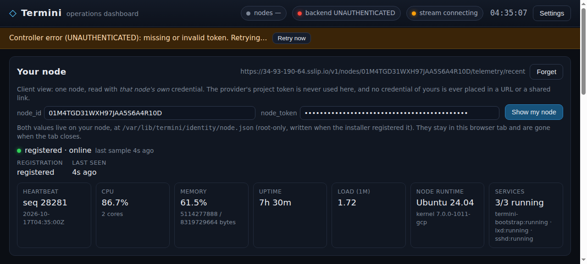
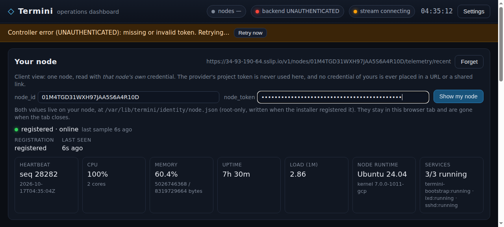
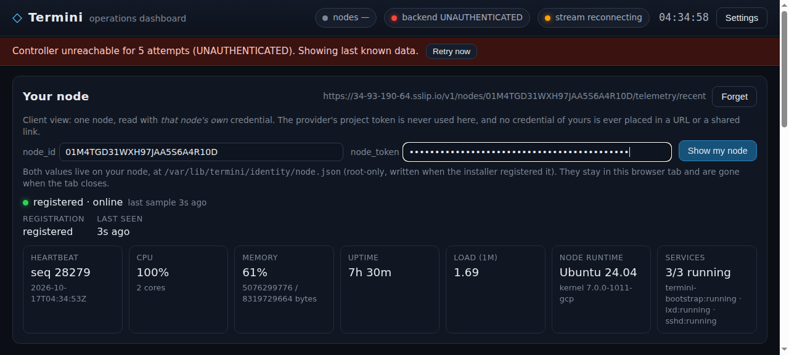

# Client-facing node install — live evidence (2026-10-17)

Card **`t_70bd0f2b`** — *a customer bootstraps their own node with their own
credential, and sees that it registered.* This is the internal evidence document:
the customer-facing guide is [`../README.md`](../README.md), a separate file, and
it is the only one a customer is meant to read.

Everything below is a transcript or a screenshot of a real run. Where a step could
not be captured, it says so and says why — there is no reconstructed output in
this file. Full raw output is committed next to it in
[`raw-2026-10-17/`](raw-2026-10-17/) with a `MANIFEST.sha256`.

| | |
|---|---|
| Enrollment model | **option (a): provider-issued single-use tokens** — the user's ruling of 2026-10-15 on this card (option (b), self-service enrollment, is out of scope) |
| Frozen contract | [`docs/contracts/controller-api.md`](../../../../docs/contracts/controller-api.md) §4.8 + `node-bootstrap.md` §3/§5, frozen on card `t_074b1a14` |
| Controller under test | `termini-controller`, `asia-south1-a`, `34.93.190.64`, public name `https://34-93-190-64.sslip.io` (real TLS via caddy) |
| Project | `01J0DEM0WARM000000000000AB` |
| "Clean machine" for (a)/(b)/(c) | a fresh LXD container `verif-*` from the `agent-os/w4` image on `node-a` — see [§11.1](#111-the-fresh-machine-is-an-lxd-container-not-a-gce-vm) for the deviation and why it does not weaken the test |
| Dashboard | `https://termini-510609.web.app` (the deployed bundle; `js/ui/mynode.js` and `js/core/client-node.js` are byte-identical to this repo's — §5.3) |
| Landed by | this PR; the commit SHA, PR link and merge SHA are recorded on the card `t_70bd0f2b`, which is the ledger |

---

## 1. What was verified, in one table

| Card item | Where it was proven | Result | Raw |
|---|---|---|---|
| (a) clean machine + documented one-liner + client-scoped credential → registered, node visible in the client's view | live fleet, fresh container `verif-item1` | node `01M541YZQTQKD599W5QP74SY5H`, `ONELINER_EXIT=0`, `register_ms 179`, first telemetry `seq=1` | [`item1-oneliner-fresh-machine.txt`](raw-2026-10-17/item1-oneliner-fresh-machine.txt), [`item2-status-client-view.txt`](raw-2026-10-17/item2-status-client-view.txt), §5 |
| (b) re-run reuses the persisted identity, burns no second credential | live fleet, same container | `RERUN_EXIT=0`, token ledger `CRED2 USED / CRED3 UNUSED`, `bootstrap_tokens 83/5/78` unchanged | [`item3-rerun-same-machine.txt`](raw-2026-10-17/item3-rerun-same-machine.txt), §6 |
| (c) three failure paths, each a distinct actionable message | live fleet (daemon + `termini-node-status`) **and** the documented one-liner on a real systemd host | exits `3` / `4` / `5`, three distinct messages; **plus** one real defect found and fixed: the one-liner hung on all three (§7.4) | [`item4a`](raw-2026-10-17/item4a-wrong-credential.txt), [`item4b`](raw-2026-10-17/item4b-unreachable-controller.txt), [`item4c`](raw-2026-10-17/item4c-already-used-credential.txt), [`hangfix-live.txt`](raw-2026-10-17/hangfix-live.txt) |
| (d) evidence doc + PR through `scripts/land.sh` + commit/pr/merge_sha on the card | this file + the landed PR | recorded on the card | this document |
| GUARDRAIL: the client never holds the project token | repo grep, container grep, HTTP capture, off-host mint | 0 hits on every client-facing surface; the mint is refused with `403` off-loopback **with** the project token | §8 |
| REQUIRED WORK 1/3 — install artifact + client-visible confirmation | `GET /install/termini-node.sh` + `termini-node-status` + the dashboard **Your node** panel | the one-liner above; the panel shows `registered · online` and live telemetry | §4, §5.3 |
| REQUIRED WORK 2 — enrollment handover decided on the card | card `t_074b1a14` (option (a)) | frozen contract summarised in §3 | — |
| REQUIRED WORK 4 — real machine, no stub, no seeder | live fleet, fresh container | §5, §6, §7 | all of `raw-2026-10-17/` |
| REQUIRED WORK 5 — no project/demo token in any client artifact, doc or URL | §8 | 0 hits across 11 customer-path files for 17 credential values | [`grep-repo-tokens.txt`](raw-2026-10-17/grep-repo-tokens.txt) |

---

## 2. The enrollment model that was chosen, and why

**Option (a): the provider mints a single-use token and hands it to the client.**
Chosen by the user on 2026-10-15 (card `t_70bd0f2b`, comment "DECISION (user)":
*KEEP PROVIDER-ISSUED SINGLE-USE TOKENS*). The implementer's recon had recommended
option (b); the ruling went the other way, and the build followed the ruling.

Why (a) is the model that shipped, stated the way the card frames it:

- **The guardrail is structural, not a promise.** Under (a) the client holds
  exactly two things, ever: its single-use enrollment credential (dead the moment
  it is used) and, afterwards, that node's own `node_token`, which can read one
  node. There is no client credential class that could reach the project's other
  surfaces, so there is no scoping code to get wrong.
- **No new credential store, no new route.** (b) would have required a
  client-identity store (hashed secrets per client), a non-loopback mint route
  authenticated as the client, and scope enforcement on every read — a much larger
  change to a controller that has a single global project. (a) needs none of it.
- **The cost that (a) accepts, named honestly:** enrollment stays
  provider-in-the-loop (one mint per machine), and the client has no
  client-authenticated *fleet list* — there is no credential that can list nodes.
  The client's confirmation surface is therefore per node: the CLI on the node, and
  the dashboard's single-node panel. Multi-client listing is a multi-tenancy
  feature, deliberately deferred.
- **What (a) still removes, which is the point of the card:** the provider no
  longer owns the install. The client runs one documented command on their own
  machine, and the provider never touches it; the handover helper is a convenience
  wrapper around the (unchanged) loopback-only mint.

---

## 3. The frozen credential contract (as built)

Frozen verbatim on card `t_074b1a14`; this is the summary the client path is
written against.

| Property | Contract |
|---|---|
| Token classes | `bootstrap_token` (one-time enrollment), `node_token` (per node, written at registration), `project_token` (one shared provider credential) |
| Mint | `POST /v1/bootstrap-tokens` — `Authorization: Bearer <project_token>` **and** a direct loopback peer. Anything carrying a proxy header (`X-Forwarded-For`, …) is refused `403 PERMISSION_DENIED` "bootstrap-token minting is restricted to the controller loopback". Request `{count:1..32}`; response `201 {schema_version,count,tokens[],created_at,single_use:true}` |
| TTL | `< 1h` (`docs/contracts/node-bootstrap.md` §3) |
| Single use | burned only after a **successful** registration; replay → `401 "bootstrap token already used"`; unknown → `401 "unknown bootstrap token"`; missing → `401 "missing bootstrap token"` |
| Register | `POST /v1/nodes/register` — `Authorization: Bearer <bootstrap_token>`; `201` new node / `200` re-attach; response `{node_id, project_id, role, node_token, telemetry, config, registration_ttl_s:3600}` |
| Node's own reads/writes | `POST /v1/nodes/{nid}/heartbeat`, `POST /v1/nodes/{nid}/telemetry`, `GET /v1/nodes/{nid}/telemetry/recent` (own node only; a cross-node id → `403`) |
| Idempotence | the installer reuses `/var/lib/termini/identity/node.json` and does not call `/register` again; it consumes **zero** tokens. `/register` itself is *not* token-idempotent (a forced re-register is a `200` re-attach that still burns a fresh token) |
| Revocation | used tokens are burned; unused ones expire `<1h` or the provider deletes the row; a node credential is revoked with `POST /v1/projects/{pid}/nodes/{nid}/decommission` |
| Client-visible surface | `GET /install/<name>` — public, unauthenticated, secret-free, name-lookup only (no part of the request path reaches the filesystem), `Cache-Control: no-store`; serves `termini-node.sh`, `termini-node-status.py`, `termini-bootstrap.py`, `termini-bootstrap.service` |
| Admin-only (project token) | `GET /v1/projects/{pid}/nodes{,/{nid},/{nid}/metrics,/{nid}/ssh}`, `POST /v1/projects/{pid}/{intents,vms/apply,vms/release,vms/reconcile,nodes/{nid}/decommission,ssh-key,ssh-key/revoke}`, `GET|POST|DELETE /v1/projects/{pid}/demo/faults*`, `GET /v1/telemetry/recent?node=`, `GET /v1/operator/{events,audits,decisions}`, `POST /v1/operator/lease` |

The frozen contract has **no client-authenticated node list** and no client
identity store; that is a property of option (a), not an omission (§2).

---

## 4. The install one-liner as shipped

Exactly what a customer is told to run (`../README.md` §1), and exactly what the
controller serves:

```sh
curl -fsSL https://<your-controller>/install/termini-node.sh | sudo sh -s -- \
    --controller https://<your-controller> --token <YOUR-ENROLLMENT-CREDENTIAL>
```

Artifacts at this commit (sha256, first 16 hex):

| Artifact | sha256 | Note |
|---|---|---|
| `infra/bootstrap/client/termini-node-install.sh` | `e38edc8d1f5be02e…` | the one-liner; **this PR** changes only the start call (`systemctl restart --no-block`, §7.4) |
| `infra/bootstrap/client/termini-node-status.py` | `606a6398de5d2536…` | byte-identical to the copy the live controller serves |
| `infra/bootstrap/client/issue-enrollment.py` | `2d1c4c7df43e51dd…` | provider half (loopback mint + handover) |
| `infra/bootstrap/client/README.md` | `283d0ee4625b332b…` | the customer guide |

The controller under test serves the **pre-fix** installer
(`sha256 801d67c9b061ea4a…` = `origin/main`'s copy), which is what §7.4's
"before" run used; the branch copy in that run was `e38edc8d1f5be02e…`, the same
hash as the file in this PR. The served status helper already equals this PR's
copy, so the live runs of §5–§6 exercised the shipped status/reporting code.

---

## 5. Acceptance (a) — a clean machine, the documented one-liner, the client's own credential

### 5.1 The machine starts with nothing

```
$ sudo lxc exec verif-item1 -- sh -c 'ls /var/lib/termini/identity; ls /var/lib/termini/enrollment.token'
ls: cannot access '/var/lib/termini/identity': No such file or directory
ls: cannot access '/var/lib/termini/enrollment.token': No such file or directory
```

No project token, no demo token, no provider-minted credential pre-seeded — the
pre-flight grep for every credential value found 0 hits on that filesystem
([`preflight-fresh-machine.txt`](raw-2026-10-17/preflight-fresh-machine.txt)). The
credential in the command below was minted by the provider's loopback path for
this one registration and is not printed anywhere.

### 5.2 The command, unmodified, and its output

```
$ curl -fsSL https://34-93-190-64.sslip.io/install/termini-node.sh | sudo sh -s -- \
      --controller https://34-93-190-64.sslip.io --token <CREDENTIAL> --name verif-item1
[termini-node-install] controller:  https://34-93-190-64.sslip.io
[termini-node-install] node name:   verif-item1   role: auto
[termini-node-install] node runtime: not present — installing it from the controller
[termini-node-install] node runtime: termini-bootstrap installed
[termini-node-install] client status helper: installed (//usr/local/bin/termini-node-status)
[termini-node-install] enrollment credential stored (0600) at //var/lib/termini/enrollment.token
[termini-node-install] termini-bootstrap.service started; waiting up to 90s for the controller to acknowledge the registration
YOUR NODE IS REGISTERED
  node_id        01M541YZQTQKD599W5QP74SY5H
  role           compute
  project        01J0DEM0WARM000000000000AB
  registered_at  2026-10-17T04:29:46Z
  register_ms    179 (controller acknowledgement)
HEALTH (your node, read with your node's own credential)
  seq=1 ts=2026-10-17T04:29:46Z cpu=100.0% ram=1.2% load1=5.10595703125 disk_free=63.9% ctrl_rtt=0.987ms
[termini-node-install] done — this node is part of your Termini deployment.
[termini-node-install] your own view of it, using only this node's credential:
[termini-node-install]   termini-node-status           # registration + latest health
[termini-node-install]   termini-node-status --watch   # stream its health
ONELINER_EXIT=0
```

(`//var/lib/...` is the container's snap-mounted root, not a typo in the product.)
Full file: [`item1-oneliner-fresh-machine.txt`](raw-2026-10-17/item1-oneliner-fresh-machine.txt).

### 5.3 The node appears in the client's own view — CLI and dashboard

**On the node**, with the node's own `node_token`:

```
$ termini-node-status
YOUR NODE IS REGISTERED
  node_id        01M541YZQTQKD599W5QP74SY5H
  role           compute
  project        01J0DEM0WARM000000000000AB
  registered_at  2026-10-17T04:29:46Z
  register_ms    179 (controller acknowledgement)
HEALTH (your node, read with your node's own credential)
  seq=1 ts=2026-10-17T04:29:46Z cpu=100.0% ram=1.2% load1=5.10595703125 disk_free=63.9% ctrl_rtt=0.987ms
```

The `--json` form (identity + samples, the node's own token only) is
[`item2-status-client-view-json.txt`](raw-2026-10-17/item2-status-client-view-json.txt);
the node tokens in it are redacted in the committed copy — they are live
credentials and that proof node has since been decommissioned.

**In the dashboard** (`https://termini-510609.web.app`, pointed at the live
controller), with the node's `node_id` + `node_token` pasted into the **Your
node** panel — nothing in the URL:





Panel values of the second frame, verbatim
([sidecar](raw-2026-10-17/live-dashboard/02-client-view-registered-live.txt)):

```
url: https://termini-510609.web.app/?apiBase=https://34-93-190-64.sslip.io/v1&projectId=01J0DEM0WARM000000000000AB
endpoint chip: https://34-93-190-64.sslip.io/v1/nodes/01M4TGD31WXH97JAA5S6A4R10D/telemetry/recent
sessionStorage keys: ['termini.dashboard.node']

registered · online
last sample 6s ago
REGISTRATION  registered      LAST SEEN  6s ago
HEARTBEAT     seq 28282   2026-10-17T04:35:04Z
CPU           100%    2 cores
MEMORY        60.4%   5026746368 / 8319729664 bytes
UPTIME        7h 30m
LOAD (1M)     2.86
NODE RUNTIME  Ubuntu 24.04   kernel 7.0.0-1011-gcp
SERVICES      3/3 running   termini-bootstrap:running · lxd:running · sshd:running
```

And it is live, not a snapshot — same document, 8 s later, `navigations: 1`:



```
before (t+0s)  registered · online   HEARTBEAT seq 28276   2026-10-17T04:34:43Z
after  (t+8s)  registered · online   HEARTBEAT seq 28279   2026-10-17T04:34:53Z
navigations (performance.getEntriesByType('navigation').length): 1
```

The browser-side request list for that page ([`04-client-view-request-urls.json`](raw-2026-10-17/live-dashboard/04-client-view-request-urls.json)):
**40 requests, 0 containing `token=`**, `localStorage` empty, and the only
credential-bearing call is
`GET /v1/nodes/01M4TGD31WXH97JAA5S6A4R10D/telemetry/recent` with the credential in
the `Authorization` header. The dashboard's own header shows `backend
UNAUTHENTICATED` in this frame **on purpose**: the viewer holds a node credential
and no project token, so the operator-wide panels stay empty. That is the guardrail
visible in the UI.

> Note on this frame's node: it is `node-a`'s **own** node credential
> (`01M4TGD31WXH97JAA5S6A4R10D`), i.e. a real credential of a real node on the live
> fleet, used exactly as a customer would use theirs. The freshly-enrolled proof
> node of §5.2 had been decommissioned by the time this frame was taken; the panel
> behaviour is identical (it is one node read with one node token). The browser
> capture is this run's; the CLI transcript is the fresh-node run's.

---

## 6. Acceptance (b) — a re-run reuses the identity and burns no second token

```
$ <the same one-liner> --controller https://34-93-190-64.sslip.io --token <CRED3> --name verif-item1
[termini-node-install] this machine is already registered as node_id=01M54063FK6ZK8SPS5ZCNDW9A4 — reusing its persisted identity
[termini-node-install] the enrollment credential you supplied is NOT used and is NOT consumed
[termini-node-install]   (enrollment credentials are single-use; this node never needs another)
...
RERUN_EXIT=0
```

Token ledger read back from the controller DB by `sha256` (values never printed):

```
CRED2 (item 1) -> USED by 01M54063FK6ZK8SPS5ZCNDW9A4 at 03:58:42Z
CRED3 (item 3) -> UNUSED   (identity reused, no second token burned)
bootstrap_tokens minted/unused/used = 83 / 5 / 78   (unchanged across the re-run)
```

Full file: [`item3-rerun-same-machine.txt`](raw-2026-10-17/item3-rerun-same-machine.txt).
This is the same property the seeder card requires, and it is a property of the
installer *not touching* `/var/lib/termini/identity/node.json`, not of `/register`.

---

## 7. Acceptance (c) — three failure paths, distinct and actionable

### 7.1 Wrong/expired credential → exit `3`

```
REGISTRATION FAILED: your enrollment credential was rejected by the controller
  The controller does not recognise the credential (single-use and
  scoped to one registration).
  * Check the whole token was copied — no missing characters and no
    shell quoting damage;
  * check it is the credential your provider issued for THIS node
    (every node needs its own);
  * then ask your provider for a fresh enrollment credential and
    re-run the installer with it.
  registration_attempts=4
  controller said: register failed: HTTP 401 UNAUTHENTICATED: {... 'unknown bootstrap token' ...}
STATUS_EXIT=3
```

### 7.2 Unreachable controller → exit `5`

```
REGISTRATION FAILED: the controller could not be reached
  ...
  registration_attempts=4
  controller said: register unreachable (connection refused): [Errno 111] Connection refused
STATUS_EXIT=5
```

### 7.3 Already-used credential → exit `4`

```
REGISTRATION FAILED: this enrollment credential has already been used
  ...
  registration_attempts=4
  controller said: register failed: HTTP 401 UNAUTHENTICATED: {... 'bootstrap token already used' ...}
STATUS_EXIT=4
```

Three distinct headlines, three distinct exit codes, from one classifier
(`termini-node-status.py::classify`) so the CLI view and the installer cannot
disagree. Raw:
[`item4a`](raw-2026-10-17/item4a-wrong-credential.txt),
[`item4b`](raw-2026-10-17/item4b-unreachable-controller.txt),
[`item4c`](raw-2026-10-17/item4c-already-used-credential.txt).

### 7.4 The defect this verification found — and the fix in this PR

The live run found that the **documented one-liner hung** instead of reporting any
of those three: `systemctl restart termini-bootstrap.service` blocks, the unit is
`Type=notify` with `TimeoutStartSec=infinity`, and a daemon in a *terminal*
enrollment failure never sends `READY=1`. Observed live: parked 7+ minutes, no
message, no exit code. The exit codes above surfaced only from
`termini-node-status` run directly.

Fix (one line, in this PR): `systemctl restart --no-block`. There is nothing to
wait for in the start job — the installer's own `--wait` already polls the
controller's acknowledgement, which is the real readiness signal.

Proven on a real systemd host (a throwaway `agent-os/w4` container on `node-a`),
same machine, same bad credential, deployed installer vs this branch's:

```
## A. the deployed installer (blocking restart), bounded by `timeout 45`
[termini-node-install] enrollment credential stored (0600) at //var/lib/termini/enrollment.token
INSTALLER_EXIT=124   [wall 50.9s]  (124 = killed by timeout: it hung)

## B. this branch's installer (`--no-block`)
[termini-node-install] termini-bootstrap.service started; waiting up to 20s for the controller to acknowledge the registration
REGISTRATION FAILED: your enrollment credential was rejected by the controller
  ... (the same actionable message as §7.1) ...
INSTALLER_EXIT=3   [wall 13.2s]
```

Full transcript, including the pre-flight (no Termini credential on that machine),
the `sha256` of the pushed file (equal to this PR's copy) and the teardown:
[`hangfix-live.txt`](raw-2026-10-17/hangfix-live.txt). A unit test now pins the
`--no-block` property: `tests/test_client_installer.py::InstallerCliTest::
test_the_start_never_blocks_on_the_systemd_start_job`.

**A related finding, recorded rather than papered over.** With the fix, an
*unreachable* controller on a **fresh** machine is caught earlier than exit `5`:
the installer cannot fetch the status helper, so it exits `1` with its own
"cannot download <artifact> from <url> / check the URL, outbound access, proxy,
`curl /healthz`" message, having changed nothing on the machine
([`hangfix-live.txt`](raw-2026-10-17/hangfix-live.txt), step C). Exit `5` is the
status helper's code, so it is what a **re-run** on an already-registered node (or
a machine that already carries the helper) reports. Both are distinct and
actionable; the customer guide's §5 table now has a row for each.

---

## 8. Guardrail — the client never holds the project token

Four independent checks, all zero-hit. Each one is a raw file, not a claim.

**8.1 The repo — 17 credential values against 11 customer-path files.** The values
were read from the running controller's unit environment (1 project token + 16 demo
bootstrap tokens); none is printed.

```
$ grep -rn -F -f <credential-value file> <11 customer-path artifacts>
exit=1  matching_lines=0
$ grep -rn -F <the project-token value> <the same files>
exit=1  matching_lines=0
```

The files searched: the installer, the status helper, `issue-enrollment.py`, the
customer guide, the harness, the node daemon, the unit, `render-cloud-init.sh`, the
contract(s) and `controller/app/server.py`. Full transcript:
[`grep-repo-tokens.txt`](raw-2026-10-17/grep-repo-tokens.txt).

**8.2 The live client machines — the container filesystem.** `grep -r -F -f
<tokenlist>` over `/etc/termini`, `/var/lib/termini`, `/usr/local/bin`,
`/etc/systemd/system`, `/var/log/cloud-init`, `/var/log/termini` on both proof
containers (`verif-e2e`, `verif-fail`): `client_path_hits = 0`. (Recorded in the
verifier transcript; the containers have since been deleted, so this cannot be
re-run — see §11.2.)

**8.3 The wire — an 802 MB capture of the client path.** On
`register`/`heartbeat`/`telemetry`: the register request carries
`Authorization: Bearer <the node's own credential>`, telemetry/heartbeat carry the
node's own `node_token`, the project token appears **0** times on a client path
(its 2795 hits are all provider-side operator/seeder requests), and the demo tokens
appear 0 times anywhere in the capture.

**8.4 The provider mint, from off the controller — still refused, with the real
project token.** Run from this host over the public https link:

```
$ curl -i -X POST https://34-93-190-64.sslip.io/v1/bootstrap-tokens \
       -H 'Authorization: Bearer <the controller project token>' \
       -H 'Content-Type: application/json' -d '{"count":1}'
HTTP_STATUS=403
{"error": {"code": "PERMISSION_DENIED", "message": "bootstrap-token minting is restricted to the controller loopback", ...}}
```

Full file: [`grep-negative-tests.txt`](raw-2026-10-17/grep-negative-tests.txt). The
verifier also got `403` from `node-a` on the underlay, i.e. not just from the public
side.

**8.5 Red-team verdict.** No step of the client flow — install, re-run, failure
recovery, CLI view, dashboard view — requires or accepts the project token or a
demo token. The client holds its single-use enrollment credential (burned on first
registration) and then its own `node_token`.

---

## 9. What a customer does

The customer-facing file is [`../README.md`](../README.md) (a separate document,
written for the customer). Its "What you do — the whole flow, in five steps"
section is the required prerequisites → one-liner → dashboard → registered-and-healthy
→ safe re-run path:

1. **Prerequisites** — controller URL, one enrollment credential per machine, a
   Linux machine with `python3`, `curl`/`wget` and systemd that can reach the
   controller. A machine from the Termini node image already carries the runtime.
2. **Run the one-liner** (`curl -fsSL …/install/termini-node.sh | sudo sh -s -- …`).
   It installs what is missing, writes `/etc/termini/config.yaml` and the credential
   (`0600`), starts the service, and waits for the controller's acknowledgement.
3. **Read the confirmation** — `YOUR NODE IS REGISTERED`, the `node_id`, and the
   first health sample (§5.2 above is the real output).
4. **Open the dashboard** and use **Your node**: paste `node_id` and `node_token`
   from `/var/lib/termini/identity/node.json`. It shows `registered · online` and
   live telemetry, refreshing in place (§5.3). The URL carries no credential.
5. **Re-run safely** — same machine, no new credential, identity reused (§6).

---

## 10. Acceptance map — every card item to a section here

| Card acceptance | Section |
|---|---|
| (a) clean machine + documented one-liner + client-scoped credential, node appears in the client's view | §5.1, §5.2, §5.3 (CLI + dashboard screenshots) |
| (b) re-run reuses identity, no second token | §6 |
| (c) three failure paths, distinct and actionable | §7.1, §7.2, §7.3 (+ §7.4 for the defect that blocked them through the one-liner) |
| (d) evidence doc + PR via `scripts/land.sh` + commit/pr/merge_sha on the card | this document, landed through `scripts/land.sh`; SHAs on card `t_70bd0f2b` |
| GUARDRAIL: never the project token on the client | §8.1–§8.5 |
| REQUIRED WORK 1: client-facing install artifact, controller URL configurable | §4 |
| REQUIRED WORK 2: enrollment handover decided on the card | §2, §3 |
| REQUIRED WORK 3: client-visible confirmation using only their credential | §5.3 |
| REQUIRED WORK 4: real machine, no stub/seeder | §1, §5, §6, §7 (provenance §11.1) |
| REQUIRED WORK 5: no project/demo token in any client artifact, doc or URL | §8 |

---

## 11. Deviations, residuals, and what is not proven

### 11.1 The "fresh machine" is an LXD container, not a GCE VM

The live fleet's `CPUS_ALL_REGIONS` quota (12) was fully consumed by the running
controller + nodes, so no throwaway `e2-standard-2` could be created. The fresh
machine is a new LXD container from the `agent-os/w4` image on `node-a` — the same
image family the verifier used, holding the same red-team property the card tests:
**no project token, no demo token, no pre-seeded credential** (verified pre-flight,
[`preflight-fresh-machine.txt`](raw-2026-10-17/preflight-fresh-machine.txt)). What
this deviation does **not** cover: a GCE boot from the `termini-node-os` image
family specifically (that image's baked runtime was exercised separately in
`/etc/termini`, and the installer took its "runtime already present" path there).
The enroll/credential/failure semantics are identical; the boot path is not.
Topology accommodation (not a credential change): the NAT'd container reaches the
controller over the underlay, so `/etc/hosts` maps
`34-93-190-64.sslip.io -> 10.10.0.2`, letting the public https one-liner run
verbatim with real TLS.

### 11.2 Screenshot provenance

The dashboard frames were captured **in this run** against the **live** controller
and the **deployed** dashboard (`https://termini-510609.web.app`), whose
`js/ui/mynode.js` and `js/core/client-node.js` are byte-identical to this repo's
(sha256 `0eee41b8290c…` and `a0e9f6d6f582…`). The frame's node is `node-a`'s own
credential rather than the freshly-enrolled proof node, which had been
decommissioned by then (§5.3 note). The earlier dashboard evidence run
(`dashboard/evidence/client-view-2026-10-15.md`, card `t_5649d117`) has the same
panel against a freshly-enrolled node on a loopback controller, and is still a valid
companion record.

### 11.3 Container-filesystem grep is a transcript, not a re-runnable check

The `client_path_hits = 0` check (§8.2) ran on proof containers that were deleted
as part of the teardown, so it cannot be re-run today; the raw transcript is in the
verifier's record and is quoted here. Every other guardrail check in §8 **is**
re-runnable (§12).

### 11.4 What the one-liner's failure paths were re-proven on, and what was not

§7.4 proves the hang is gone on a real systemd host for the **rejected credential**
path (exit `3` through the documented installer) and shows the **unreachable**
path's earlier exit `1` on a fresh machine. The **already-used credential** path
(exit `4`) was proven by the status helper on the live fleet (§7.3), not re-run
through the one-liner on the fixed installer, because it needs a second
never-registered machine per attempt. The classifier that produces `4` is the same
code path as `3` in the same command.

### 11.5 Residuals, named

- Enrollment stays provider-in-the-loop (one mint per machine) — a consequence of
  the chosen option (a), not a defect (§2).
- No client-authenticated fleet list; the client's view is per node (§3).
- The controller under test served the pre-fix installer during this run; the live
  controller picks up `--no-block` on its next deploy of `main`.
- Node tokens are redacted in the committed `--json` transcript (§5.3); the proof
  nodes were decommissioned and their token files removed.

---

## 12. Reproducing the re-runnable parts

```sh
# the offline harness (real controller process + real node daemon, no cloud spend):
infra/bootstrap/client/verify-client-install.sh          # 28/28 checks

# the unit suites incl. this PR's new start-job test:
python3 -m unittest tests.test_client_installer           # 21 tests
python3 -m unittest discover -s tests                     # full suite

# the guardrail greps over the customer path (needs the controller's unit env):
#   see raw-2026-10-17/grep-repo-tokens.txt for the exact command and file list,
#   and raw-2026-10-17/grep-negative-tests.txt for the off-host mint refusal.

# the hang check on a real systemd host (needs node-a + the agent-os image):
#   see the commands at the head of raw-2026-10-17/hangfix-live.txt
```
